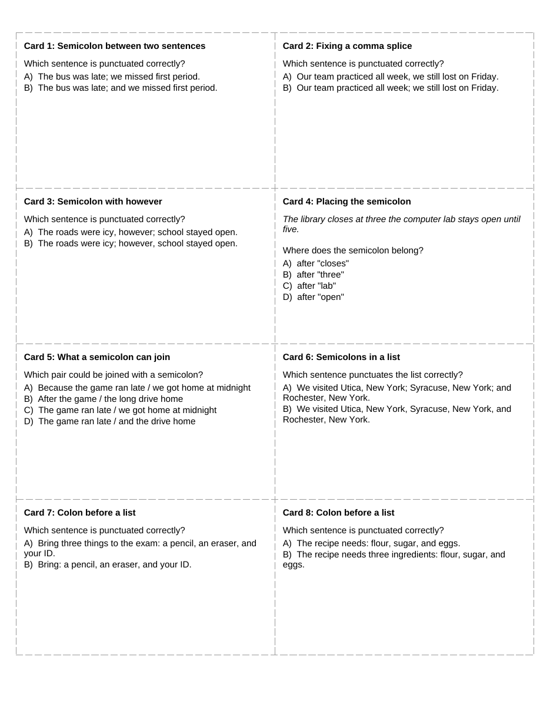
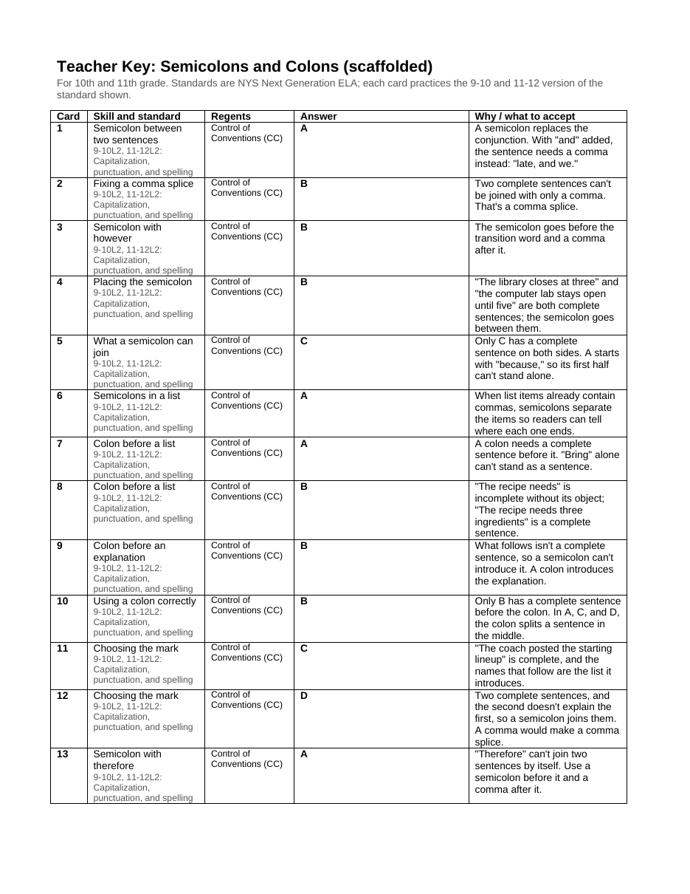

# Bell Ringer Cards

A Claude skill that makes printable sets of 20 bell ringer cards, with a teacher answer key, for high school English classes preparing for the New York State ELA Regents exam. Every card is tagged to a NYS Next Generation ELA standard and to a controlled vocabulary of Regents skills, and a build script checks those tags before anything is printed.

I designed it for a high school English teacher in a small rural New York district who was making card sets by hand with a general-purpose chatbot, then printing them, cutting them apart, and pasting each one onto an index card.



## The problem

Bell ringers are the 3 to 5 minute warm-ups at the start of class. This teacher's workflow had three pain points:

1. **Errors were expensive.** A card is only useful once it's cut out and pasted onto an index card. A wrong answer, an ambiguous question, or a card that overflows its space means redoing physical work, so "mostly right" output wasn't good enough.
2. **The standards weren't the useful label.** State standards codes (9-10R1, 11-12L2) are what curriculum documents use, but what the teacher needed to see was the Regents connection: which part of the exam a skill shows up on and which rubric row it affects.
3. **Nothing tracked what had been covered.** Without a record, sets repeated skills and gaps went unnoticed.

## What it does

Asked for something like "semicolons for 10th and 11th, they're really weak on this," Claude:

- plans 20 cards that move from recognizing the skill to using it to harder applied cases;
- writes them as structured JSON, tagged with a standard and Regents skill IDs;
- runs `scripts/build_cards.py`, which validates the set and builds a Word file: cards 8 to a page with dashed cut lines, sized to fit a 3x5 index card, followed by a teacher key;
- records the set in a CSV log, so the next request can avoid repeats and point out gaps.

A complete example set is in [`examples/`](examples/): the [source JSON](references/example-set.json), the [Word file](examples/Bell%20Ringers%20-%20Semicolons%20and%20Colons.docx), and a [PDF](examples/Bell%20Ringers%20-%20Semicolons%20and%20Colons.pdf).



## Design decisions

### A controlled vocabulary for Regents skills

[`references/regents-vocabulary.md`](references/regents-vocabulary.md) defines the terms cards can be tagged with, drawn from NYSED's Educator Guide to the exam and its scoring rubrics. It is organized in four facets:

| Facet | What it captures | Examples |
|---|---|---|
| Exam part | Where on the exam the skill counts | `P1` Reading Comprehension, `P2` Argument Essay, `P3` Text-Analysis Response |
| Rubric criterion | Which scored row of the essay rubrics it affects | `CE` Command of Evidence, `CC` Control of Conventions |
| Task skill | A specific thing the exam asks students to do | `P1-EVID` Best supporting evidence, `P2-COUNTER` Counterclaim |
| Writing strategy | The literary techniques named for Part 3 | `WS-TONE`, `WS-SYMBOL`, `WS-IRONY` |

Each term has a stable ID, a definition, the exam part it belongs to, and its source. The instructions are explicit: use only these IDs, only where the connection is real, and never invent new terms. A tag that doesn't add information makes the key harder to scan, so "tag only where it's true" matters as much as the list itself.

### Rules enforced by validation, not left to good intentions

The model writes the content, but a script decides whether the set gets built. Before producing anything, `build_cards.py` rejects a set if:

- it doesn't have exactly 20 cards;
- a standard or Regents ID isn't in the reference files;
- a multiple-choice answer isn't one of the choices, or two choices are identical;
- a card is too long to fit its 4 by 2.4 inch space;
- a card refers to another card ("Using the sentence from Card 3..."), which breaks once the cards are cut apart.

When a check fails, the script prints what to fix and builds nothing, so a bad set never gets as far as the paper cutter or the log.

### Tagging policy for edge cases

Some tagging rules exist because the standards themselves are uneven:

- **Shared sets span two grade bands.** One set serves both 10th and 11th grade, so the key shows each card's standard in both the 9-10 and 11-12 versions.
- **Two anchors change meaning between bands.** R3 and R7 have different labels in 9-10 and 11-12 (for example, 9-10 R7 is about comparing formats, while 11-12 R7 is about adaptations and integrating sources). For those, each card must declare which band's version it practices, and the build fails if it doesn't.
- **Evidence cards split by task.** Finding or inferring from evidence while reading is tagged R1. Writing a response that uses evidence is tagged W5.
- **Plain-language labels.** Each standard carries a short label ("Evidence and inference") so the key is readable without looking up codes.

### Separating the reusable skill from local context

Everything specific to one teacher lives in [`references/teacher-profile.md`](references/teacher-profile.md): grades taught, which grades share a set, class length, the written-response framework used in class (RACES in the example), house style rules such as pronoun agreement, and where files live. The skill itself (instructions, vocabulary, standards, and validation) stays the same from teacher to teacher.

### Data informs suggestions, and the teacher decides

[`references/priorities.md`](references/priorities.md) summarizes class-level diagnostic results. When the teacher asks what to work on, Claude reads the log and offers two or three options from the priorities, with a reason for each. It doesn't otherwise bring up the data and doesn't switch to multiple choice unless the teacher agrees. The copy in this repository is **sample data with invented numbers**, included only to show the format.

## Repository layout

```
SKILL.md                      Instructions Claude follows
scripts/build_cards.py        Validates a set and builds the Word file and log entry
references/
  teacher-profile.md          Local context for one teacher (example values)
  regents-vocabulary.md       Controlled vocabulary of Regents skills
  vocabulary.json             The same vocabulary, as data the script reads
  standards.md                NYS Next Generation ELA standards used, with labels
  standards.json              The same standards, as data the script reads
  priorities.md               Class-level assessment summary (sample data)
  example-set.json            A complete 20-card set
examples/                     The example set built as Word and PDF
```

## Using it

1. Fill in `references/teacher-profile.md`, and replace `priorities.md` with your own class-level summary or delete it.
2. Zip the folder and add it as a skill in Claude.
3. Ask for a set: "20 bell ringers on citing evidence for 10th and 11th."

The build script needs Python 3 and `python-docx`. To build a set by hand:

```bash
python3 scripts/build_cards.py my-set.json "Bell Ringers - My Set.docx" --log "Bell ringer log.csv"
```

## Status

The skill is complete but hasn't been used in a classroom yet. This repository documents the design.

## Credits

Designed by Jessica Burgoyne, built with Claude.

Standards wording in `references/standards.md` is quoted from the New York State Next Generation English Language Arts Learning Standards, and the Regents vocabulary is drawn from NYSED's Educator Guide and rubrics for the Regents Examination in English Language Arts. That material belongs to the New York State Education Department and is not covered by this repository's license.

## License

MIT, for everything except the NYSED material noted above. See [LICENSE](LICENSE).
